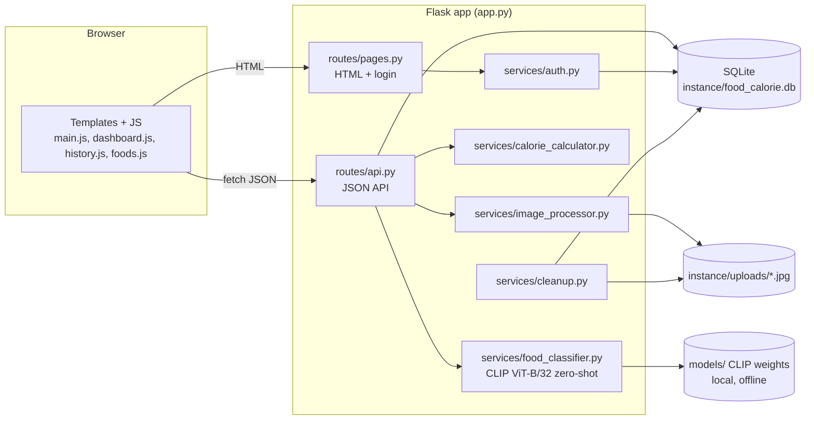
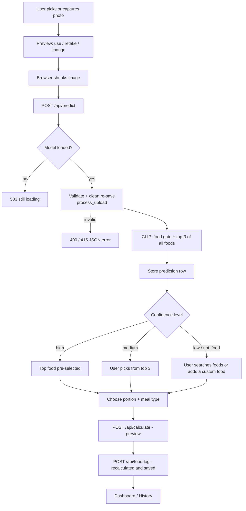
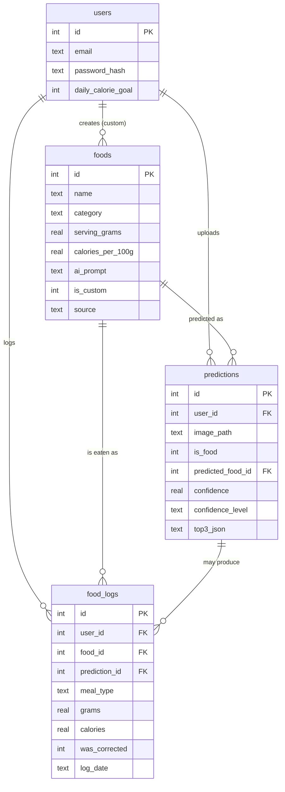

# PROJECT_CONTEXT.md — AI Food Calorie Counter Using Food Images

> Handover document for continuing this project with ChatGPT.
> Audit date: **2026-10-15**. Method: read-only inspection of the repository, plus one safe execution (the existing pytest suite, run with the project's own `.venv`) and one read-only SQLite query. **No application code was changed.** This is the only file created in this audit.
>
> **Note on `PROJECT_STATUS.md`:** it was rewritten on 2026-10-15 as a short status page that agrees with this file. The older audit it replaced (2026-10-10) is gone.
>
> **Updates after the audit (2026-10-15):** project put under git and pushed to https://github.com/rolenson26/Calorie-Counter; README corrupted lines and test count fixed; developer's manual photo tests recorded (§4 #6–#7). **Multi-food selection in one step implemented** (§4 #7, §8, T12), then **3–8 AI suggestions per photo** (`pick_suggestions`, `SUGGESTION_MIN_CONFIDENCE=0.04`, `MAX_SUGGESTIONS=8`), a **"+ Add a food"** tile, and **creating a missing food in a pop-up on the scan page** (`templates/_new_food_modal.html`, `POST /api/foods`). The "AI's top guess / AI suggestion" labels were removed from result rows at the developer's request. Tests now **183 passed**. The developer has **deferred** HLD/report/viva documents and CSRF protection.

---

## 0. Final Handover Summary

| Item | Result |
|---|---|
| **Project name** | AI Food Calorie Counter Using Food Images (college mini project, BTech CSE) |
| **Development stage** | Software is feature-complete and well tested on the server side. Remaining work: **real browser/phone verification, accuracy evidence, and college documentation (HLD diagrams, report, viva)** |
| **Overall status** | Core workflow **photo → AI guess → confirm/correct → portion → calories → save → dashboard/history** is implemented end to end. **165 automated tests pass** (verified this audit). The UI JavaScript has **no automated tests** and I did not open it in a browser |
| **Completion estimate** | **≈ 70 %** weighted (see §4 for the calculation); **63 %** strict (Complete only). This counts software *and* documentation. The software alone is clearly further along than the documentation |
| **Main working features** | Register/login, photo upload, image validation, CLIP zero-shot recognition of 73 foods with confidence levels, not-food gate, manual food search/correction, portion selection, calorie and macro calculation, SQLite storage, meal edit/delete, history, dashboard data, quick-add recent foods, unused-photo cleanup, dark mode, offline model loading |
| **Main incomplete features** | The AI offers at most 3 suggestions per photo and does not locate separate items (the user taps the foods that are present, now several at once); portion is user-chosen, never estimated from the photo; dashboard charts and mobile layout not systematically checked; no CSRF protection (deferred); no HLD diagrams or report files in the repo (deferred) |
| **Critical blockers** | **None.** No P0 issue found |
| **Recommended next task** | Finish the browser dry run (dashboard, history, edit/delete, phone) and fix what it reveals (§13, T1–T2). Multi-food detection is the main feature gap, scheduled as future work |
| **Last audit date** | 2026-10-15 |

---

## 1. Project Identity

**Title.** AI Food Calorie Counter Using Food Images.

**Purpose.** A web app where a user photographs or uploads a meal. An AI suggests what the food is, the user confirms or corrects it and chooses a portion, and the app estimates calories, protein, carbohydrates, fat and fiber and records the meal in a daily dashboard.

**Problem statement** (inferred from the README and code; the formal statement is not in the repo). Tracking calories by hand is slow and error-prone, and most food-tracking tools focus on Western foods. This project recognises common Indian dishes from a photo and turns them into nutrition estimates with minimal typing.

**Objectives (as implemented).**
1. Recognise a food from a single photo using a pretrained model (no training).
2. Keep the user in control: show confidence, offer the top 3 guesses, allow search and correction.
3. Calculate nutrition from a nutrition table and a user-chosen portion.
4. Store meals and show daily/weekly totals.
5. Run on an ordinary laptop with no GPU, offline after the model is downloaded.

**Intended users.** Individuals tracking daily calories, mainly in India (Indian-food focus). For the college submission, the examiners and the student demonstrating it.

**Main features.** See the matrix in §4.

**Expected final outcome for the college submission** (the student has to confirm this against their syllabus): a working demo, a project report, an HLD with diagrams, screenshots, a test report, and viva readiness.

**Academic requirements still to produce** (none of these exist as files in the repo; see §11): HLD and diagrams (architecture, DFD 0/1, ER, use case, sequence), project report, screenshots, demonstration script, viva Q&A, presentation slides.

> **Disclaimer in the app/README:** nutrition values are approximate estimates for typical recipes and portions, not medical advice.

---

## 2. Actual Technology Stack (confirmed from `requirements.txt`, code and installed `.venv`)

| Layer | Technology | Evidence |
|---|---|---|
| Language | Python 3.13.0 in `.venv` (README says "3.11 or newer") | `.venv\Scripts\python.exe --version` |
| Backend | Flask 3.1.3, Werkzeug 3.1.9, Jinja2 3.1.6 | `pip list` |
| Image processing | Pillow 12.3.0 (server); canvas resize in the browser | `services/image_processor.py`, `static/js/main.js` |
| AI runtime | PyTorch 2.14.1 (CPU), Hugging Face `transformers` 5.18.0 | `pip list`, `requirements.txt` |
| **Model** | **`openai/clip-vit-base-patch32`**, used **zero-shot** (no training, no fine-tuning) | `config.py: MODEL_NAME` |
| Model files | `models/models--openai--clip-vit-base-patch32/` (Hugging Face cache layout). Two large blobs of about 605 MB each (`pytorch_model.bin` and `model.safetensors`) | directory listing |
| Database | SQLite via the standard `sqlite3` module, **no ORM**, file `instance/food_calorie.db` | `database/db.py` |
| Frontend | Jinja2 templates + vanilla JavaScript, Bootstrap 5 and Chart.js **stored locally** in `static/vendor/` (no CDN) | `templates/`, `static/` |
| Charts | Chart.js (weekly bars) plus CSS meters | `static/js/dashboard.js` |
| Tests | pytest 9.1.1; `pytest.ini` sets `pythonpath = .` and `testpaths = tests` | `pytest.ini` |
| Dependency manager | `pip` + `requirements.txt` (version ranges, not pinned) + virtualenv `.venv` | `requirements.txt` |
| External APIs/services | **None at runtime.** Network is needed only for `pip install` and the first model download | code review |
| Nutrition sources | Indian Nutrient Databank (INDB) and USDA FoodData Central, copied into `database/nutrition_data.py` with a `source` string per food | file header |

**Assumptions / not confirmed:** the exact commit of CLIP weights is whatever Hugging Face served when downloaded (snapshot hash `3d74acf9…`/`c237dc49…` folders exist). Nutrition numbers were not re-checked against INDB/USDA.

---

## 3. Repository Structure and Important Files

Excluded from the listing: `.venv/`, `__pycache__/`, `.pytest_cache/`, the model blobs, and minified vendor files.

```
food-calorie-counter/
├── app.py                      ENTRY POINT. create_app() factory, error handlers, background CLIP loader
├── config.py                   All settings (limits, thresholds, paths, model name)
├── requirements.txt            Flask, Pillow, torch, transformers, pytest
├── pytest.ini                  pythonpath=., testpaths=tests
├── README.md                   Install / run / use / test / troubleshoot / credits
├── PROJECT_STATUS.md           OLDER audit (2026-10-10), partly stale
├── PROJECT_CONTEXT.md          THIS file
├── .gitignore                  ignores .venv, caches, instance/*, models/*
├── routes/
│   ├── pages.py                HTML pages, login/register/logout, private photo route
│   └── api.py                  JSON API under /api
├── services/
│   ├── food_classifier.py      CLIP loading + inference + CLI (--evaluate)
│   ├── image_processor.py      validate, EXIF-rotate, RGB, resize, strip metadata, save
│   ├── calorie_calculator.py   portion -> grams -> nutrients, daily summary, custom-food validation
│   ├── auth.py                 register/login/logout, login_required, safe_next
│   └── cleanup.py              delete scanned photos never saved to a meal (>24 h old)
├── database/
│   ├── schema.sql              4 tables, 2 indexes
│   ├── db.py                   ALL SQL, connection handling, seeding
│   └── nutrition_data.py       73 foods (static Python list with sources)
├── templates/                  base, index (scan), dashboard, history, foods, login, register, error, _edit_meal_modal
├── static/
│   ├── js/                     main.js, dashboard.js, history.js, foods.js, meal-ui.js, common.js
│   ├── css/style.css           custom styles, dark mode, media queries
│   ├── img/example-thali.jpg   sample photo used on the home page
│   └── vendor/                 bootstrap.min.css, bootstrap.bundle.min.js, chart.umd.min.js
├── tests/                      conftest.py + 9 test modules (165 tests)
├── models/                     local Hugging Face cache of CLIP (≈1.2 GB, git-ignored)
└── instance/                   runtime data: food_calorie.db, uploads/ (git-ignored)
```

There is **no `docs/` folder, no Dockerfile, no CI config, and no git repository.**

### 3.1 File-by-file

| File | Purpose / implements | Key items | Depends on | Status |
|---|---|---|---|---|
| `app.py` | Builds the app; registers blueprints and error handlers; starts the model in a background thread so pages open at once | `create_app(config_overrides, classifier)`, `start_loading_classifier`, `register_error_handlers`; CLI `--host`, `--port`; `debug=False` | `config`, `database.db`, `routes.*`, `services.cleanup` | Implemented |
| `config.py` | Settings | `SECRET_KEY` (env or random per start), upload limits, `MODEL_NAME`, `MODEL_CACHE_DIR`, thresholds `HIGH_CONFIDENCE=0.60`, `LOW_CONFIDENCE=0.30`, `FOOD_GATE_THRESHOLD=0.50`, `DEFAULT_CALORIE_GOAL=2000`, `UNUSED_PHOTO_MAX_AGE_HOURS=24` | – | Implemented |
| `routes/pages.py` | HTML routes | `/`, `/dashboard`, `/history`, `/foods`, `/uploads/<name>` (owner only), `/register`, `/login`, `/logout` | `services.auth`, `database.db` | Implemented |
| `routes/api.py` | JSON API | see §8 | services, `database.db` | Implemented |
| `services/food_classifier.py` | `FoodClassifier` (CLIP), `confidence_level`, `prompts_for`, `Guess`, `ClassificationResult`; CLI `python -m services.food_classifier [--evaluate folder] photo.jpg` | `classify`, `set_foods`, `add_food`, `encode_image/text` | `torch`, `transformers` | Implemented |
| `services/image_processor.py` | Upload checks and clean re-save | `load_image`, `process_upload`, `save_image`, `ImageValidationError` | Pillow | Implemented |
| `services/calorie_calculator.py` | Nutrition math (pure Python) | `portion_to_grams`, `nutrients_for`, `calculate`, `daily_summary`, `validate_custom_food` | – | Implemented |
| `services/auth.py` | Accounts | `register_user`, `check_login`, `log_in`, `current_user`, `login_required`, `safe_next` | `werkzeug.security`, `db` | Implemented |
| `services/cleanup.py` | Removes unused photos | `delete_unused_photos`, `run` (throttled, never raises) | `db` | Implemented |
| `database/db.py` | Every SQL statement | `init_db`, `add_food_log`, `update_food_log`, `get_logs`, `get_daily_totals`, `get_recent_foods`, `get_ai_accuracy`, … | `schema.sql`, `nutrition_data` | Implemented |
| `database/nutrition_data.py` | 73 foods, 16 categories | `FOODS` list | – | Implemented (values not re-verified) |
| `static/js/main.js` | Scan page: live camera, preview/retake, shrink + upload, confirm, portion, save | `openCamera`, `usePhoto`, `showConfirm`, `calculate`, `save` | `common.js`, API | Implemented, **no JS tests** |
| `static/js/dashboard.js`, `history.js`, `foods.js`, `meal-ui.js`, `common.js` | Other pages and shared helpers | – | API | Implemented, **no JS tests** |
| `tests/conftest.py` | Test app with temp DB and a `FakeClassifier` | fixtures `app`, `client`, `auth_client`, `food_id`, `photo` | – | Implemented |

**Run commands (Windows PowerShell, from the project folder):**
```powershell
.venv\Scripts\python app.py                    # http://127.0.0.1:5000
.venv\Scripts\python app.py --host 0.0.0.0     # also reachable from a phone on the same Wi-Fi
.venv\Scripts\python -m pytest                 # tests
```

---

## 4. Current Development Status (feature matrix)

Legend: **T** = covered by the pytest run I executed (165 passed). **R** = code read only. **DB** = evidence in the dev database. I did **not** open the app in a browser, so anything that depends on JavaScript or CSS rendering is "code read" at best.

| # | Feature | Status | Evidence | Tested? | Limitations / remaining |
|---|---|---|---|---|---|
| 1 | Home/scan page and UI | **Unverified** | `templates/index.html`, `static/js/main.js`, `routes/pages.py: index` | T: page renders (`test_pages.py`). JS flow not tested. DB shows 7 predictions + 1 saved meal, so the flow was used at least once | Needs a browser dry run |
| 2 | Image upload | **Complete** | `api.py: predict`, `image_processor.process_upload`; DB has 7 stored predictions and 7 files in `instance/uploads/` | T (`test_api.py`) | – |
| 3 | Camera capture | **Unverified** | `main.js`: `getUserMedia` live preview (HTTPS/localhost only) with fallback to `<input capture="environment">` | T: only that the inputs exist | Never tested on a real phone. Over plain `http://192.168.x.x` phones block the live preview and use the camera app instead (documented in README) |
| 4 | Image validation | **Complete** | `image_processor.py`: extension allow-list, Pillow must decode as JPEG/MPO/PNG/WEBP, 40 MP cap, 8 MB request cap | T (`test_image_processor.py`, API tests) | HEIC unsupported (documented) |
| 5 | Image preprocessing | **Complete** | EXIF rotate, RGB, ≤1024 px, re-encode JPEG (drops EXIF/GPS); CLIP processor resizes to 224 px | T | – |
| 6 | AI food classification | **Partial** | `FoodClassifier.classify`: CLIP zero-shot over the 73 foods | T: 2 tests with real CLIP on a plain colour image (shape only, not accuracy). **Manual (developer, 2026-10-15):** single foods from the 73-food list are recognised well from different angles (informal, no counted figure) | Only the 73 DB foods are predictable. One label per photo. README accuracy (77 % top-1 / 93 % top-3 on 658 photos) **cannot be reproduced from the repo** |
| 7 | Multiple foods per photo | **Complete** (user-selected; added 2026-10-15) | "Your plate" in `templates/index.html` + `static/js/main.js` (`addFood`, `removeFood`, `renderPlate`, `buildPlateItem`, `calculate`, `save`); `POST /api/food-log/batch` (`routes/api.py: add_food_logs`); `db.add_food_logs` (one transaction) | T: 13 API cases + 2 DB tests. **Browser-verified** (headless Edge, phone width, real CLIP, thali photo): select/deselect, search add, per-food portions, per-food error, total + rows, back keeps plate, save 3 meals, dashboard total | The AI ranks the whole photo and does not *detect* separate items; it offers 3–8 likely foods (`pick_suggestions`) and the user taps the ones that are there, adds others with "+ Add a food", or creates a missing food in a pop-up. Up to 10 foods per save. `predictions.top3_json` still stores only the top 3. Before this change only one food could be chosen per calculation (developer's manual test) |
| 8 | Confidence score | **Complete** | `_probabilities` (softmax over labels), `confidence_level`; thresholds in `config.py` | T (`confidence_level`) | Relative, not calibrated (see §6) |
| 9 | Unknown / not-food handling | **Complete** | Food gate (5 food vs 7 non-food prompts) → `not_food`; low level asks the user to search; `LEVEL_MESSAGES` | T (API tests with fake classifier) | Gate and thresholds tuned by hand |
| 10 | Manual food correction | **Complete** | `GET /api/foods?q=`, `add_food_log` sets `was_corrected`; search UI in `main.js` | T (API); UI not tested | – |
| 11 | Portion selection | **Complete** | `calorie_calculator.portion_to_grams`; quantity in servings (0.25–20) or typed grams (1–3000) | T (`test_calculator.py`) | **User-chosen only; never estimated from the photo** |
| 12 | Calorie calculation | **Complete** | `nutrients_for`, `calculate`; recomputed server-side on save | T (e.g. 250 g × 104 kcal/100 g = 260 kcal) | Estimate only |
| 13 | Protein / carbs / fat / fiber | **Complete** | same functions | T | – |
| 14 | Nutrition dataset | **Complete** | `nutrition_data.py`: 73 foods, each with a `source` string (INDB or USDA record) | T (`test_nutrition_data.py`: data sanity) | Numbers **not re-checked** against INDB/USDA. Some foods omitted on purpose (gulab jamun, jalebi, pakora, bhatura) |
| 15 | Database integration | **Complete** | `schema.sql`, `db.py`; parameterised queries; CHECK constraints and FKs on | T (`test_database.py`) | – |
| 16 | Food history | **Complete** (API) | `GET /api/history` (≤31 days), `static/js/history.js` | T (API); page JS not tested | – |
| 17 | Daily calorie totals | **Complete** | `db.get_daily_totals`, `daily_summary` | T | – |
| 18 | Dashboard and charts | **Unverified** | `dashboard.js` (Chart.js bars, meters, stacked split), `GET /api/dashboard` | T: API numbers only | Chart rendering never observed |
| 19 | Edit / delete saved meal | **Complete** (API) | `PUT/DELETE /api/food-log/<id>`, `meal-ui.js`, `_edit_meal_modal.html` | T: `test_edit_meal_*`, `test_delete_only_your_own_meal` | Food itself cannot be changed (delete and re-add) |
| 20 | Accounts / auth | **Complete** | `services/auth.py`, salted password hashes, per-user data | T (`test_auth.py`, ownership tests) | No password reset/change |
| 21 | Responsive design and dark mode | **Unverified** | `style.css` has media queries (max-width 575.98 px, 399.98 px, min-width 576/768/992 px) and dark-mode variables; `base.html` sets `data-bs-theme` | T: none | Never rendered on a phone |
| 22 | Error handling | **Complete** | `app.py: register_error_handlers`, `ApiError`, `error.html` | T (clean 404/405/413/500, JSON vs HTML) | – |
| 23 | Offline inference | **Complete** | `FoodClassifier.load` tries `local_files_only=True` first; Bootstrap/Chart.js are local | T: real-CLIP tests loaded the local model this audit. Old audit ran it with offline env flags (`HF_HUB_OFFLINE=1`) | I did not disconnect the network myself this time |
| 24 | Security and validation | **Partial** | See §10 | T (many) | **No CSRF tokens**, no rate limiting, no security headers, random `SECRET_KEY` per restart unless set |
| 25 | Automated testing | **Partial** | 165 tests (§9) | T | No JS/browser tests, no real end-to-end test, API tests use a fake classifier, no accuracy test in the suite |
| 26 | Technical documentation | **Partial** | `README.md` (good), docstrings in every module | – | README has 2 corrupted lines and a stale test count (§10) |
| 27 | HLD and college documents | **Not Implemented** (in repo) | No `docs/`; README links to two external claude.ai artifact pages ("Architecture & HLD", "Project report") that I **could not inspect** | – | Module docstrings cite "HLD Module 2/3/4/6" and "section 4/9/10", so an HLD probably exists elsewhere |

**Counts (27 features, after the multi-food change):** Complete **18** · Partial **4** (#6, #24, #25, #26) · Unverified **4** (#1, #3, #18, #21) · Not Implemented **1** (#27) · Blocked **0**.

**Completion calculation (my own convention):** weighted = (Complete × 1 + Partial × 0.5 + Unverified/Not Implemented/Blocked × 0) / total = (18 + 2) / 27 = **74.1 %**. Strict = 18 / 27 = **66.7 %**. (Before the multi-food change: 70.4 % / 63.0 %.) Unverified counts as zero, because nothing was observed working.

---

## 5. Actual Application Architecture

### 5.1 Data flow (as implemented)

| # | Step | File / function | State |
|---|---|---|---|
| 1 | User picks, uploads, or captures a photo | `templates/index.html`, `static/js/main.js` | Implemented (JS unverified) |
| 2 | Browser shrinks the image to ≤1280 px, POSTs it | `main.js: shrinkImage, usePhoto` → `POST /api/predict` | Implemented |
| 3 | Backend validates and saves a clean JPEG | `api.py: predict` → `image_processor.process_upload` | Implemented, tested |
| 4 | CLIP inference | `FoodClassifier.classify` | Implemented, tested (real model on dummy image only) |
| 5 | Prediction stored | `db.add_prediction` (`predictions` table) | Implemented |
| 6 | Top-3 and confidence level returned | `api.py: predict` | Implemented |
| 7 | User confirms or corrects (search `/api/foods?q=`) | `main.js` | Implemented |
| 8 | Portion chosen; preview | `POST /api/calculate` → `calorie_calculator.calculate` | Implemented, tested |
| 9 | Save meal; nutrition **recomputed server-side** | `POST /api/food-log` → `db.add_food_log` (copies nutrient values into `food_logs`) | Implemented, tested |
| 10 | Dashboard / history | `GET /api/dashboard`, `GET /api/history`, `dashboard.js`, `history.js` | API tested; UI unverified |

**Hard-coded or simplified items:** default serving grams per food; confidence thresholds (configurable in `config.py`); generic AI prompt for user-added foods (`"a photo of <name>, a dish of food"` in `db.add_custom_food`). **No mocked behaviour in the real app** (the fake classifier is test-only). **No disconnected modules found.**

### 5.2 Architecture diagram



### 5.3 Workflow diagram



**Planned but not implemented:** detecting several foods in one photo; estimating portion size from the image; HLD diagrams in the repo.

---

## 6. AI Model and Nutrition Logic

| Question | Answer | Where |
|---|---|---|
| Model used | CLIP ViT-B/32, `openai/clip-vit-base-patch32` (image encoder + text encoder, 512-dim embeddings) | `config.py` |
| Pretrained weights local? | **Yes**, in `models/models--openai--clip-vit-base-patch32/` | directory listing; real-CLIP tests loaded them |
| How loaded | `CLIPModel.from_pretrained(..., local_files_only=True)`; if that raises `OSError`, it downloads once | `food_classifier.py: FoodClassifier.__init__` |
| Loaded when | In a background thread at app start (~5–6 s). `/api/predict` returns 503 until ready; `/api/status` reports `model_ready` | `app.py: start_loading_classifier` |
| Supported classes | 73 seeded foods in 16 categories, plus any custom foods added later (they become labels immediately, no retraining) | `nutrition_data.py`, `FoodClassifier.add_food` |
| Prediction → name | Each food has 3 sentences (`ai_prompt`, `a photo of <name>, a type of food.`, `a close-up photo of <name>.`), embedded and averaged into one vector. Photo vector × food vectors → softmax → top 3 | `prompts_for`, `food_vectors_for`, `classify` |
| Confidence | `softmax(100 × cosine_similarity)` over **the labels in the database** (100 = CLIP's learned logit scale). Levels: `high ≥ 0.60`, `medium 0.30–0.60`, `low < 0.30`, `not_food` if the food gate fails | `_probabilities`, `confidence_level`, `config.py` |
| Food gate | Probability mass on 5 food prompts vs 7 non-food prompts; `is_food = food_probability ≥ 0.50` | `FOOD_PROMPTS`, `NOT_FOOD_PROMPTS` |
| Nutrition retrieval | Per-100 g values from the `foods` table row of the chosen food (static table, **not** produced by the model) | `db.get_food` |
| Portion | `grams = quantity × serving_grams` **or** the grams the user types | `portion_to_grams` |
| Formulas | `nutrient eaten = nutrient_per_100g × grams / 100`; calories rounded to whole numbers, others to 1 decimal. Dashboard energy split uses 4 kcal/g protein and carbs, 9 kcal/g fat | `nutrients_for`, `daily_summary` |
| Mixed dishes / unknown foods | One label per photo. Mixed plates (thali) are handled by the user logging each item. Unknown foods fall to `low` or `not_food`, and the user searches or adds a food | `classify`, UI |
| Works offline after setup? | **Yes.** Model loads from `models/`, and Bootstrap/Chart.js are local | code + tests |
| Speed | About 0.04–0.10 s per photo on CPU after a ~6 s load (measured in the 2026-10-10 audit; not re-measured now) | old audit |

**What the system can reliably infer from one photo:** which of its known foods looks most similar, and whether the image looks like food at all.
**What it cannot do:** recognise arbitrary foods, separate several items on one plate, measure portion size or oil/ghee content, or give exact calories. The calorie number is only as good as (a) the food label the user confirms, (b) the portion the user picks, and (c) an average per-100 g recipe value. The confidence number is a **relative** score among the known labels, not a probability that the answer is correct.

**Do not claim** universal food recognition or exact calorie measurement in the report or viva.

---

## 7. Database

SQLite file `instance/food_calorie.db`; schema in `database/schema.sql`; seeded automatically from `nutrition_data.py` on first run. Foreign keys are enabled per connection (`PRAGMA foreign_keys = ON`).

| Table | Key fields | Relationships / constraints |
|---|---|---|
| `users` | `id`, `name`, `email` (UNIQUE, NOCASE), `password_hash`, `daily_calorie_goal` (800–5000), `created_at` | – |
| `foods` | `id`, `name` (UNIQUE), `category`, `serving_unit`, `serving_grams`, `calories/protein/carbs/fat/fiber_per_100g` (range CHECKs), `ai_prompt`, `is_custom`, `created_by`, `source` | `created_by → users(id) ON DELETE SET NULL` |
| `predictions` | `id`, `user_id`, `image_path`, `is_food`, `predicted_food_id`, `confidence`, `confidence_level`, `top3_json`, `created_at` | `user_id → users CASCADE`; `predicted_food_id → foods SET NULL` |
| `food_logs` | `id`, `user_id`, `food_id`, `prediction_id`, `meal_type` (breakfast/lunch/dinner/snack), `quantity`, `grams`, `calories`, `protein`, `carbs`, `fat`, `fiber`, `was_corrected`, `log_date`, `logged_at` | `user_id → users CASCADE`; `food_id → foods`; `prediction_id → predictions SET NULL`; index `(user_id, log_date)` |

**Persistence behaviour:** nutrient values are **copied** into `food_logs` at save time, so history does not change if a food row changes. Custom foods are shared by all users. Unused predictions (and their photos) older than 24 h with no linked meal are deleted at startup and, at most once an hour, when a photo is scanned.

**Dev database snapshot (read-only query, 2026-10-15):** users **2**, foods **73** (0 custom, 16 categories), predictions **7**, food_logs **1**; 7 files in `instance/uploads/`.



---

## 8. API Endpoints (`routes/api.py`, mounted at `/api`)

All routes need login (JSON 401 otherwise) except `/api/status`. Responses are `{"success": true, ...}` or `{"success": false, "error": "..."}`.

| Method | Path | Purpose | Request | Main response fields | Status |
|---|---|---|---|---|---|
| GET | `/api/status` | Is the model ready? | – | `model_ready`, `model_error` | Implemented, tested |
| POST | `/api/predict` | Photo → top-3 foods | multipart field `image` | `prediction_id`, `image_url`, `is_food`, `food_probability`, `confidence_level`, `top_predictions[]`, `message` | Implemented, tested (fake classifier) |
| POST | `/api/calculate` | Preview nutrition (nothing saved) | JSON `food_id` + (`quantity` xor `grams`) | `food`, `grams`, `quantity`, `calories`, `protein`, `carbs`, `fat`, `fiber` | Implemented, tested |
| POST | `/api/food-log` | Save a meal (201) | JSON `food_id`, `meal_type`, `quantity`/`grams`, optional `prediction_id` | `log_id`, `nutrition`, `today{consumed,goal,remaining}` | Implemented, tested |
| POST | `/api/food-log/batch` | Save several foods from one plate (201), all-or-nothing | JSON `meal_type`, optional `prediction_id`, `items: [{food_id, quantity` or `grams}]` (1–10) | `log_ids`, `items[]` (food + nutrition), `totals`, `today` | Implemented, tested, browser-verified |
| PUT | `/api/food-log/<id>` | Change meal type / portion | JSON `meal_type`, `quantity` or `grams` | `log_id`, `nutrition`, `meal_type`, `day` | Implemented, tested |
| DELETE | `/api/food-log/<id>` | Delete own meal | – | `success` | Implemented, tested |
| GET | `/api/history` | Meals in a date range (`from`, `to`, ≤31 days, default last 7) | query | `from`, `to`, `logs[]` | Implemented, tested |
| GET | `/api/dashboard` | Totals and chart data for a day (`date` optional) | query | `meals_count`, `totals`, `by_meal_type`, `last_7_days`, `meals`, `goal/consumed/remaining/percent_of_goal/energy_split_percent` | Implemented, tested |
| GET | `/api/foods` | List or search foods (`q`, max 20 results) | query | `foods[]` | Implemented, tested |
| GET | `/api/foods/recent` | Your recently logged foods (quick add) | – | `foods[]` | Implemented, tested |
| POST | `/api/foods` | Add a custom food (201); becomes an AI label immediately | JSON name, category, serving_unit, serving_grams, calories, protein, carbs, fat, fiber | `food` | Implemented, tested |
| PUT | `/api/user/goal` | Set daily goal (800–5000) | JSON `daily_calorie_goal` | `daily_calorie_goal` | Implemented, tested |

**Page routes** (`routes/pages.py`): `GET /`, `/dashboard`, `/history`, `/foods`, `/uploads/<name>` (photo owner only), `GET/POST /register`, `GET/POST /login`, `POST /logout`.
**Not present:** edit/delete a custom food, change password, export data, delete a photo or prediction.

---

## 9. Testing and Verification

**Command:**
```powershell
.venv\Scripts\python -m pytest -p no:cacheprovider -q
```
**Result I observed on 2026-10-15: 165 passed, 0 failed, 0 skipped, in 15.9 s.** After the multi-food change the same day: **180 passed** (+1 login check, +12 batch-API cases, +2 database tests; per-module numbers below are from before that change).

| Module | Tests | Type |
|---|---|---|
| `test_api.py` | 62 | Integration (Flask test client, temp SQLite, **fake classifier**) |
| `test_auth.py` | 15 | Integration |
| `test_calculator.py` | 30 | Unit |
| `test_cleanup.py` | 6 | Integration |
| `test_database.py` | 11 | Unit/integration (temp DB) |
| `test_food_classifier.py` | 9 | Unit; **2 use the real CLIP model** (guarded by `skipif` when `models/` is missing; they ran, they were not skipped) |
| `test_image_processor.py` | 11 | Unit |
| `test_nutrition_data.py` | 5 | Data sanity |
| `test_pages.py` | 16 | Integration (HTML render) |

(Counts come from `pytest --collect-only`; they sum to 165.)

**Mocked vs real:** API tests use `FakeClassifier` from `tests/conftest.py`. Real CLIP is exercised only by two tests on a plain colour image, which check output *shape*, not accuracy.

**Not covered:** JavaScript behaviour, charts, camera, mobile layout, true end-to-end (browser → server → real model → DB), recognition accuracy on real photos, concurrency.

**Verified this audit:** the test suite passes; the dev DB opens read-only and has all four tables.
**Not verified this audit:** starting the Flask server, using the app in a browser, offline operation by disconnecting the network, nutrition numbers against sources, README accuracy figures.
**Previously verified (older audit, not repeated):** an offline smoke test of the real model on three stored photos.

Manual tests still required: the full flow on a laptop browser and a phone, camera permission handling, dashboard charts, dark mode, narrow-window layout, deleting/editing a meal.

---

## 10. Decisions Made, Known Issues and Blockers

### 10.1 Decisions evident from the repo (do not reverse without reason)

| Decision | Basis |
|---|---|
| **CLIP zero-shot instead of training a classifier**; new foods become labels with no retraining | `food_classifier.py` docstring, README |
| Focus on **Indian food**, 73 foods, nutrition from INDB + USDA with a stored source | `nutrition_data.py` header |
| **Portions are user-selected; grams are never guessed from the photo** | README, `calorie_calculator.py` |
| **Human in the loop**: confidence levels decide whether to pre-select, offer top 3, or ask the user to search | `confidence_level`, `LEVEL_MESSAGES` |
| Flask + SQLite + vanilla JS, **no ORM**, no frontend framework | structure |
| All frontend libraries stored locally (offline) | `static/vendor/` |
| Photos re-encoded to JPEG (drops EXIF/GPS), random file names, served only to the owner | `image_processor.py`, `pages.py` |
| Nutrients copied into `food_logs` at save time | `schema.sql` comment |
| Deep-fried INDB recipes **not used** (they count all frying oil as eaten); USDA used instead for samosa, puri, etc. | `nutrition_data.py` header |
| Gulab jamun, jalebi, pakora, bhatura left out (no reliable record); users add them as custom foods | same |
| Unused scanned photos deleted after 24 h | `cleanup.py` |

Nothing in the repo records previous design discussions beyond these comments. Do not invent any.

### 10.2 Deployment question raised on 2026-10-15 (conversation, not repo)

The student asked whether the app can be used **offline, locally, on multiple devices, as an Android APK, without the Play Store, App Store, or using a laptop as a server.** Conclusion reached:
- A **true standalone APK is not realistic** with the current stack. PyTorch + transformers do not run on Android, and Flask is a Python server. It would need a rewrite (TensorFlow Lite / ONNX Runtime Mobile and a native or Flutter/React Native UI), which is a different project.
- **Realistic options:** (1) run the app on one laptop and open it from phones on the same Wi-Fi/hotspot (`python app.py --host 0.0.0.0`), which already works offline; (2) a Windows `.exe` via PyInstaller (very large because of torch + model); (3) an optional PWA wrapper (still needs the server reachable).
- Already handled in the repo: Bootstrap and Chart.js are local (no CDN), and the model loads from `models/` first. So no change is needed to make the *laptop-hosted* version offline.
- **No decision has been recorded yet.** Recommended for the submission: the laptop/hotspot demo; do not promise an APK in the report.

### 10.3 Known issues

Severity scale: Critical / High / Medium / Low. There are **no Critical or High issues**.

| # | Sev. | Status | Issue | Evidence / file | Suggested fix |
|---|---|---|---|---|---|
| I1 | – | **Fixed 2026-10-15** | Was not a git repository | – | Now on GitHub: https://github.com/rolenson26/Calorie-Counter |
| I2 | Medium | Confirmed | **HLD diagrams, report, viva notes are not in the repo** | no `docs/` | Create `docs/` (T8–T10). The Mermaid diagrams in this file can seed the HLD |
| I3 | Medium | Confirmed | **README accuracy claim (77 % / 93 % on 658 photos) is not reproducible**; test photos are "not included" | `README.md`, `prompts_for` docstring | Rerun `python -m services.food_classifier --evaluate <folder>` on your own photos and quote your own numbers |
| I4 | Medium | Confirmed | **No CSRF protection** on `/login`, `/register`, `/logout`; only `SameSite=Lax` | `config.py`, templates; grep found no token code | Add Flask-WTF `CSRFProtect`, or document as a limitation |
| I5 | Medium | Unverified suspicion | Scan UI, charts, camera and mobile layout may have bugs | no JS tests; not run in a browser | Browser dry run (T1) |
| I6 | Low | Confirmed | No rate limiting, no security headers, no `Secure` cookie flag | grep | Document, or add later |
| I7 | Low | Confirmed | `SECRET_KEY` is random per start, so everyone is logged out on restart unless `SECRET_KEY` is set | `config.py` | Set the env var in the run instructions |
| I8 | – | **Fixed 2026-10-15** | README had corrupted text in the phone-camera section (lines 73 and 79) | `README.md` | – |
| I9 | Low | Partly fixed | Test count corrected to 165. Still open: README says model is 1.2 GB; `config.py` comment says about 600 MB (the cache holds two ≈605 MB weight files) | `README.md`, `config.py` | Align the model-size text |
| I10 | Low | Confirmed | Duplicate weight files (`pytorch_model.bin` and `model.safetensors`) waste ≈600 MB | `models/` | Keep only `model.safetensors` if size matters; recheck offline load |
| I11 | Low | Confirmed | API tests use a fake classifier; no real-model end-to-end test | `tests/conftest.py` | Add one real-model API test (T6) |
| I12 | Low | Confirmed | Custom foods are shared by all users and cannot be edited or deleted; their AI prompt is generic | `db.add_custom_food` | Optional |
| I13 | Low | Suspicion | A custom food added while the model is still loading might not become a label until restart (`set_foods` reads the foods list when loading finishes) | `app.py`, `api.add_food` | Low priority; test if it matters |
| I14 | Low | Confirmed | Live camera preview works only on HTTPS or localhost; over plain LAN HTTP phones fall back to the camera app | README, `main.js` | Documented behaviour |
| I15 | – | **Fixed 2026-10-15** | `PROJECT_STATUS.md` was outdated | – | Rewritten as a short current status page |
| I16 | – | **Fixed 2026-10-15** | Multi-food photos gave calories for one food only | §4 #7 | Several foods can now be selected and saved in one step |
| I17 | Low | Confirmed (open question) | In History, the 2nd and later foods of a plate show "Corrected (AI said …)", even when they were among the AI's suggestions, because `was_corrected` means "not the AI's top guess" (also used by `db.get_ai_accuracy`) | `routes/api.py: add_food_logs`, `static/js/meal-ui.js: mealAiNote` | Decide: keep (top-1 accuracy stays simple) or count any top-3 suggestion as "AI right" / add a separate label |

**What changed since the older 2026-10-10 audit:** test count 165 vs 146; `style.css` now has media queries; unused-photo cleanup now exists (`services/cleanup.py`, 6 tests); live `getUserMedia` camera preview, edit-meal modal, quick-add recent foods and dark mode now exist; dev DB now has 2 users, 7 predictions and 1 saved meal (it had 1, 3 and 0).

### 10.4 Security positives (confirmed in code and tests)

Salted password hashes (Werkzeug), parameterised SQL everywhere, upload re-encoding and size/pixel limits, random file names, owner-only photo route, open-redirect protection (`safe_next`), generic login error, text rendered with `textContent` (no `innerHTML` found in `static/js`), nutrition recomputed on the server, no secrets in source.

---

## 11. High-Level Design and College Submission Status

| Item | In repo? | Notes |
|---|---|---|
| Abstract | Partial | README intro paragraph only |
| Problem statement and objectives | Partial | Inferred in §1 of this file; not formal |
| Functional / non-functional requirements | No | Can be derived from §4 and §10.4 |
| HLD architecture diagram | **No** (Mermaid draft in §5.2) | README links an external "Architecture & HLD" page I could not inspect |
| DFD Level 0 / 1 | No | Draw from §5.1 |
| ER diagram | **No** (Mermaid draft in §7) | `schema.sql` is accurate |
| Use-case diagram | No | Actors: User (register, scan, correct, log, view dashboard/history, manage foods, set goal); System (AI inference, cleanup) |
| Sequence diagram | No | Draw from §5.3 |
| Module descriptions | Yes, in code docstrings | |
| Database design | Yes (`schema.sql`) | |
| Testing report | No | Use §9 plus your own manual test log |
| Screenshots | No | Capture during T1 |
| Project report | Not in repo | README links an external page, not inspected |
| README | Yes | Fix I8, I9 |
| Viva Q&A | No | `nutrition_data.py` has "Honest notes for the viva" as a seed |
| Presentation slides | No | |

**Check before submission:** the external HLD/report pages must match the code. They must say: CLIP zero-shot (no training), 73 foods, SQLite with the four tables above, user-selected portions (not estimated), login-based accounts, single label per photo.

---

## 12. Environment and Running Instructions (Windows PowerShell)

| Item | Value |
|---|---|
| OS | Windows 11 (developed here); README also gives macOS/Linux steps |
| Python | 3.11+ required by README; 3.13.0 in use |
| Disk / RAM | ≈3 GB disk (model 1.2 GB, libraries 0.9 GB); 8 GB RAM recommended; no GPU |
| Env variables | `SECRET_KEY` (optional; keeps logins across restarts). Optional for forcing offline mode: `HF_HUB_OFFLINE`, `TRANSFORMERS_OFFLINE`. Do not commit their values |
| Database init | Automatic on first start (creates `instance/food_calorie.db`, seeds 73 foods). Manual: `python -m database.db` |
| Model files | Must exist under `models/` for offline use; otherwise the first start downloads ≈1.2 GB |

```powershell
# one-time setup (from the food-calorie-counter folder)
python -m venv .venv
.venv\Scripts\activate
python -m pip install --upgrade pip
pip install -r requirements.txt

# run (http://127.0.0.1:5000)
python app.py
python app.py --host 0.0.0.0 --port 5000     # for phones on the same Wi-Fi (allow Python in Windows Firewall)

# optional: keep logins across restarts (use your own random value)
$env:SECRET_KEY = "<your-own-random-string>"

# tests
python -m pytest

# AI checks
python -m services.food_classifier photo.jpg
python -m services.food_classifier --evaluate my_photos     # folders named after foods, plus optional not_food / unknown_food
```

If PowerShell blocks `activate`, call the interpreter directly (`.venv\Scripts\python app.py`) or run `Set-ExecutionPolicy -Scope CurrentUser RemoteSigned` once.

**Troubleshooting**

| Problem | Fix |
|---|---|
| "The AI model is loading" never ends | First start is downloading the model, or the files in `models/` are incomplete. Watch the terminal; connect to the internet and restart |
| "Cannot reach the server" | The terminal running `python app.py` was closed |
| Phone cannot open the app | Use `--host 0.0.0.0`, same Wi-Fi, the laptop's IPv4 address from `ipconfig`, and allow Python through Windows Firewall |
| Port 5000 busy | `python app.py --port 5050` |
| iPhone photo rejected | HEIC is not supported; upload from the iPhone itself or save as JPG |
| Want an empty database | Stop the app, delete `instance\food_calorie.db` and `instance\uploads\`; it is recreated on next start |
| Everyone logged out after restart | Set `SECRET_KEY` |

---

## 13. Prioritized Roadmap (dependency order)

Effort is a rough estimate in hours for one student. **Do not rebuild** authentication, calculator, image pipeline, database layer, classifier or error handling. They work and are tested.

| # | Priority | Task | Status | Why | Files likely touched | Prerequisites | Acceptance criteria | Effort |
|---|---|---|---|---|---|---|---|---|
| T0 | P1 | Put the project under git | **Done 2026-10-15** | No history or backup (I1) | new `.git`; `.gitignore` already excludes `.venv`, `instance/*`, `models/*` | – | `git log` shows a first commit; remote backup exists | 0.5 |
| T1 | P1 | **Browser dry run, laptop and phone**: register → upload → confirm → calculate → save → dashboard → history → edit → delete; try the camera and dark mode | Partly done (developer tested photo recognition) | Biggest unverified area (I5) | whole UI | – | Every step works with no console errors; ≥5 meals saved; screenshots taken; bug list written | 1.5 |
| T2 | P1 | Fix bugs found in T1 | Pending T1 | Working end-to-end demo | `static/js/*`, `templates/*`, `static/css/style.css`, `routes/*` | T1 | T1 repeats cleanly; `python -m pytest` still 165+ passed | 1–4 |
| T3 | P1 | Measure real accuracy on your own photos (≥5 per food for ~15 foods, plus `not_food` and `unknown_food` folders) | Not done | Replace the unreproducible README claim (I3) | none (CLI) → save output to `docs/accuracy.txt` | – | Output saved; report quotes your own numbers | 2 |
| T4 | P2 | Spot-check 10 nutrition values against the cited INDB/USDA records | Not done | Credibility in viva | `database/nutrition_data.py` | – | 10 checked and noted; mismatches fixed (delete `instance\food_calorie.db` to reseed, since seeding runs only on an empty `foods` table) | 1.5 |
| T5 | P1 | HLD diagrams in `docs/` (architecture, DFD 0/1, ER, use case, sequence) | Drafts in §5, §7 | College requirement (I2) | new `docs/` | T1 | Six diagrams; every box maps to a real file or table | 3–4 |
| T6 | P2 | Add one real-model end-to-end API test | Not done | Tested path ≠ real path (I11) | `tests/` | – | Test posts a sample JPEG to `/api/predict` with real CLIP; skips cleanly if model missing | 1.5 |
| T7 | P2 | Security quick wins: document `SECRET_KEY`; add CSRF (`Flask-WTF`) or list it as a limitation | Not done | Examiner question (I4, I7) | `app.py`, `config.py`, `templates/login.html`, `register.html`, logout form | – | Decision recorded; if implemented, forms still work and tests pass | 2–3 |
| T8 | P1 | Write college documents: abstract, objectives, requirements, limitations, test report, user guide | Not done | Submission | new `docs/` | T3, T5 | §11 table has no "No" for required items; limitations list includes single label, 73 foods, user-chosen portions, approximate nutrition | 4–6 |
| T9 | P1 | Demo script and viva Q&A (one sure hit, one medium, one non-food photo ready) | Not done | Viva readiness | new `docs/viva.md` | T1–T3 | Rehearsed run <5 min; answers cover §6 | 2 |
| T10 | P3 | Tidy-up: align model-size text; optionally remove duplicate weights | README lines and test count **fixed**; rest not done | I8–I10 | `README.md`, `config.py`, `models/` | – | Text consistent; model still loads | 0.5 |
| T11 | P3 | Refresh `PROJECT_STATUS.md` | **Done 2026-10-15** | Avoid conflicting facts | `PROJECT_STATUS.md` | – | Only one current status file | 0.1 |
| T12 | P2 | **Multi-food photos**: let the user log several foods from one photo in one step (e.g. multi-select the suggestions, each with its own portion) | **Done 2026-10-15** | Main feature gap found in manual testing (I16) | `static/js/main.js`, `templates/index.html`, possibly `routes/api.py` (a batch save) and `services/food_classifier.py` | T1 | User can pick 2–4 foods from one photo, set each portion, and save them together; existing single-food flow and tests still pass | 4–8 |

**Deferred by the developer (2026-10-15):** T5 (HLD diagrams), T8 (report), T9 (viva), because they are not needed to run the program. T7 (CSRF) is also deferred. Do them later only if the college submission requires them.

---

## Instructions for ChatGPT

1. Treat this document as the project's current context, but **verify important claims against the source code** when it matters (file and function names are given throughout).
2. **Continue from the existing implementation.** Do not restart the project.
3. **Avoid unnecessary rewrites, duplicate features, and changes to working code.** The listed Complete features are tested; leave them alone unless a test or a real error shows a problem.
4. Ask for specific files or error output **only when needed**, and name the exact file or command.
5. Give **beginner-friendly, step-by-step explanations** suitable for a BTech CSE student.
6. Give **Windows PowerShell commands** where relevant (the student uses Windows 11 and a `.venv` in the project folder).
7. **Explain why** each significant change is required before asking the student to make it.
8. **Preserve the architecture** (Flask blueprints, services layer, SQLite without an ORM, vanilla JS, CLIP zero-shot) unless there is a strong reason to change it.
9. **Prioritise fixing blockers and completing the end-to-end workflow** (T0–T2) before documentation polish.
10. Help prepare the **HLD, project report, demonstration and viva** (T5, T8, T9). Reuse the Mermaid diagrams in §5 and §7.
11. **Distinguish verified functionality from assumptions.** Use the Status column in §4 and the list at the end of this file.
12. **Never claim tests or features work without evidence.** Ask the student to run the command and paste the output. Do not claim universal food recognition or exact calorie measurement.

**Suggested first task:** The project is already on GitHub (T0 done). Finish the **browser dry run (T1)**: start `python app.py`, open `http://127.0.0.1:5000`, register, scan a real food photo, save at least five meals, open Dashboard and History, and note anything that looks wrong or prints errors in the browser console (F12). Send ChatGPT the list of problems and the terminal output. Fix those (T2) before writing documents.

---

## Final Handover Notes

**Files ChatGPT should inspect first**
1. `routes/api.py` (the whole workflow contract)
2. `services/food_classifier.py` (the AI)
3. `static/js/main.js` (the scan page, the least-tested part)
4. `services/calorie_calculator.py`
5. `database/schema.sql` and `database/db.py`
6. `config.py`
7. `tests/conftest.py` and `tests/test_api.py`
8. `README.md`

**Commands**
```powershell
.venv\Scripts\python app.py
.venv\Scripts\python -m pytest
```

**Limitations of this audit**
- I did not start the Flask server or open any page in a browser. UI behaviour (JavaScript, charts, camera, responsive layout, dark mode) is judged only from code and from the server-side tests.
- I did not run the real model on food photos this time, so I cannot say how accurate it is. I did not visually review the photos in `instance/uploads/`.
- I did not verify nutrition numbers against INDB or USDA.
- I could not open the two external claude.ai pages linked in the README (HLD and report).
- There is no git history, so I cannot report on changes or authorship.
- Package versions come from the existing `.venv`; I did not run `pip install`.
- Test counts come from one pytest run and `pytest --collect-only`. I ran pytest with `-p no:cacheprovider` and bytecode writing disabled.

**Claims that still require verification**
1. The README accuracy figures (77 % top-1, 93 % top-3 on 658 photos; "73 % → 77 %" from prompt averaging).
2. That the scan page, camera, dashboard charts, history page and edit/delete modal work in a real browser, on a phone and on a narrow window.
3. That nutrition values match their cited INDB/USDA records.
4. That the app starts and the model loads with the network fully disconnected (shown in the older audit with offline flags; not repeated).
5. That the external "Architecture & HLD" and "Project report" pages match the current code.
6. The ≈0.04–0.10 s inference time and ≈6 s load time (measured in the older audit on the same machine; not re-measured).
7. That a custom food added during model loading becomes an AI label (I13).
